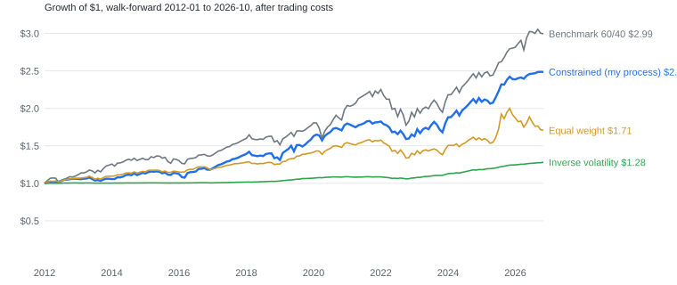

# Project 2 - Meridian Reserve Process Review: visible output

**AI use.** I used Claude (Anthropic; Claude Code desktop, model Claude Opus 5.5) to build this app's code, tests and documents and to draft the video scripts, and OpenAI Codex (GPT-5) for the Lab 13-17 code this project grows from. The analysis and the decision are mine.

**Education, not investment advice.** This is a course project on a fictional client (Meridian Foundation Reserve, Lab 13); nothing here recommends a security to anyone.

Decision as of **2026-10-30** (prices through month-end 2026-10; Treasury curve known 2026-10-29). Data downloaded 2026-11-23. Generated by `python analysis.py`.

## Recommendation: REJECT

Reject the minimum-volatility optimizer process: allocate 0% of the reserve to it. Rebalance the existing 60/40 holdings only enough to fund the payout reserve.

- **Allocation to the process:** 0% of the $100M reserve (paper-track only; no live capital)
- **Reserve allocation range:** ACWI 55-60%, AGG 35-40%, BIL 3-5% ($3-5M of T-bills covers the $3.0M twelve-month payout reserve; one-way turnover 3-5%, inside the 25% limit, so no extra committee approval is needed).
- **Reverses if:** I would change REJECT to PILOT only if the CIO confirms the loss measure and a rerun shows the window shift <= 25% with no walk-forward calendar year below -10%.

**Why**

- The process trips two of its own three stop conditions: a 60-month estimation window moves the portfolio 30 points one-way (limit 25%), and the walk-forward 2022 calendar-year loss was -10.8% (limit -10%).
- Out of sample (Jan 2012 - Oct 2026, annual December rebalances, costs charged) it returned 6.33% a year versus 7.68% for the 60/40 benchmark, below the 6.5% CPI + 4% hurdle, and was infeasible in 3 of 15 rebalance years.
- Its turnover exceeded the 25% S7 limit in 12 of 14 rebalances after the first: the allocation follows the trailing window, not the client.
- Today's answer (85% BIL / 15% ACWI) passes every rule only because ACWI's trailing 36-month mean is 20.8% a year; that is the Lab 13 'all-cash D' problem the rules cannot see.
- The fallback is not a cure either: the recommended reserve range earned 7.20-7.67% a year over the same holdout but lost 15.3-15.8% in 2022, so the objective and the loss limit cannot both be met on this evidence.
- The point-in-time term-spread signal never changed a rebalance (the curve was inverted only in the two years the process had already stopped) and has no reliable monthly edge (t = 0.08 inverted, 1.07 positive).

**Committee ask**

1. Vote to reject adoption of the optimizer process (0% allocation; I keep it on a paper track and rerun it each December).
2. Approve a compliance rebalance of the current reserve to ACWI 55-60% / AGG 35-40% / BIL 3-5%.
3. Ask the CIO to resolve the mandate conflict before any optimizer is reconsidered: on Jan 2012 - Oct 2026 data none of the five walk-forward strategies met both CPI + 4% and a 10% worst calendar-year loss. Which one gives way?

## Mandate (from Lab 13)

| Element | Rule |
|---|---|
| Objective (S2) | Expected return net of trading costs >= CPI 2.5% + 4.0% = 6.5% |
| Universe | BIL (T-bill / payout reserve), IEF (Treasury duration), AGG (U.S. investment-grade bonds (benchmark sleeve)), LQD (IG corporate credit), ACWI (Global equities (benchmark sleeve)), JOBY (Single-company satellite) |
| Benchmark (S4) | 60% ACWI / 40% AGG, current holdings assumed equal to it |
| Risk measure (S9, my interpretation) | One-year 95% parametric loss -(mu - 1.645 sigma) <= 10%; realised worst calendar year monitored |
| M3 payout reserve (S3) | BIL + IEF >= 4 x $0.75M / $100M = 3.0% |
| M4 liquidity (S8) | >= 90% redeemable within 5 business days |
| M5 issuer (S6) | No single company above 8% (funds and Treasury exempt) |
| M1, M2 (S5) | Weights sum to 100%; long-only |
| G1 turnover (S7) | <= 25% one-way a year without committee approval |

## Estimates (point-in-time window)

Window: 2023-11 to 2026-10 (36 monthly returns). Mean x 12 and standard deviation x sqrt(12) of month-end adjusted closes - historical estimates, not forecasts.

| Asset | Expected return | Volatility |
|---|---:|---:|
| BIL | 4.34% | 0.21% |
| IEF | 4.74% | 6.73% |
| AGG | 5.43% | 5.61% |
| LQD | 6.48% | 7.73% |
| ACWI | 20.78% | 11.44% |
| JOBY | 22.68% | 79.55% |

## Two baselines, my portfolio, and the benchmark - mandate verdicts

| Portfolio | Weights | Net expected return | Volatility | 95% one-year loss | Verdict (failed rule) |
|---|---|---:|---:|---:|---|
| Equal weight (baseline 1) | BIL 17%, IEF 17%, AGG 17%, LQD 17%, ACWI 17%, JOBY 17% | 10.67% | 15.42% | 14.69% | FAIL - M5, R1 (turnover needs committee approval) |
| Inverse volatility (baseline 2) | BIL 90%, IEF 3%, AGG 3%, LQD 2%, ACWI 2%, JOBY 0% | 4.71% | 0.82% | -3.36% | FAIL - O1 (turnover needs committee approval) |
| Constrained portfolio (my process) | BIL 85%, ACWI 15% | 6.77% | 1.76% | -3.87% | PASS - every checkable rule (turnover needs committee approval) |
| Benchmark 60% ACWI / 40% AGG (reference) | AGG 40%, ACWI 60% | 14.64% | 8.28% | -1.02% | FAIL - M3 |

Rule detail:

| Rule | Limit | Equal weight | Inverse volatility | Constrained portfolio | Benchmark 60% ACWI / 40% AGG |
|---|---|---|---|---|---|
| M1 Weights sum to 100% | = 100% | 100.0% pass | 100.0% pass | 100.0% pass | 100.0% pass |
| M2 Long-only (lowest weight) | >= 0% | 16.7% pass | 0.2% pass | 0.0% pass | 0.0% pass |
| M3 Reserve-eligible (BIL, IEF) >= 3.0% | >= 3.0% | 33.3% pass | 92.3% pass | 85.0% pass | 0.0% FAIL |
| M4 Redeemable in 5 business days | >= 90% | 100.0% pass | 100.0% pass | 100.0% pass | 100.0% pass |
| M5 Largest single company | <= 8% | 16.7% FAIL | 0.2% pass | 0.0% pass | 0.0% pass |
| O1 Expected return net of costs >= CPI + 4% | >= 6.5% | 10.7% pass | 4.7% FAIL | 6.8% pass | 14.6% pass |
| R1 One-year 95% loss (mu - 1.645 sigma) | <= 10% | 14.7% FAIL | -3.4% pass | -3.9% pass | -1.0% pass |
| G1 One-way turnover from current holdings | <= 25% without committee approval | 66.7% APPROVAL | 95.0% APPROVAL | 85.0% APPROVAL | 0.0% pass |

## Point-in-time signal: Treasury term spread (data card: `docs/data-card.md`)

Known on 2026-10-30: 10-year 4.98% - 3-month 4.18% = **+0.80 pts** (observation 2026-10-29, one-business-day lag). Rule result: positive (+0.80 pts): keep IEF.

Monthly test 2008-05 to 2026-10: IEF minus BIL next-month return.

| Curve known at prior month-end | Months | Mean (annualised) | t-stat | IEF beat BIL |
|---|---:|---:|---:|---:|
| positive | 183 | 1.79% | 1.07 | 50% |
| inverted | 39 | 0.34% | 0.08 | 54% |

## Stress run on estimates, window, costs and constraints

| Group | Scenario | Adjacent? | Portfolio | Net return | Volatility | Shift vs base (one-way) | Verdict |
|---|---|---|---|---:|---:|---:|---|
| Base | Base case (frozen: 36-month window, historical means, base costs; in the app: the controls set) | no | BIL 85%, ACWI 15% | 6.77% | 1.76% | 0% | PASS - every checkable rule (turnover needs committee approval) |
| Estimates | ACWI expected return -1 pt | yes | BIL 85%, ACWI 15% | 6.62% | 1.76% | 0% | PASS - every checkable rule (turnover needs committee approval) |
| Estimates | ACWI expected return -2 pts | no | BIL 80%, AGG 5%, ACWI 15% | 6.52% | 1.92% | 5% | PASS - every checkable rule (turnover needs committee approval) |
| Estimates | LQD and AGG expected return -1 pt | yes | BIL 85%, ACWI 15% | 6.77% | 1.76% | 0% | PASS - every checkable rule (turnover needs committee approval) |
| Estimates | JOBY expected return = 0% (Project 1: price above value) | yes | BIL 85%, ACWI 15% | 6.77% | 1.76% | 0% | PASS - every checkable rule (turnover needs committee approval) |
| Window | 24-month window | yes | BIL 75%, ACWI 25% | 7.07% | 2.89% | 10% | PASS - every checkable rule (turnover needs committee approval) |
| Window | 60-month window | yes | BIL 55%, ACWI 45% | 6.82% | 6.73% | 30% | PASS - every checkable rule (turnover needs committee approval) |
| Window | 120-month window | no | BIL 60%, ACWI 40% | 6.51% | 5.84% | 25% | PASS - every checkable rule (turnover needs committee approval) |
| Costs | Trading costs x4 | yes | BIL 85%, ACWI 15% | 6.65% | 1.76% | 0% | PASS - every checkable rule (turnover needs committee approval) |
| Costs | Trading costs x20 (stressed spreads) | no | BIL 80%, ACWI 20% | 6.91% | 2.33% | 5% | PASS - every checkable rule (turnover needs committee approval) |
| Constraints | No single-company holding (issuer limit 0%) | yes | BIL 85%, ACWI 15% | 6.77% | 1.76% | 0% | PASS - every checkable rule (turnover needs committee approval) |
| Constraints | Reserve minimum 10% | yes | BIL 85%, ACWI 15% | 6.77% | 1.76% | 0% | PASS - every checkable rule (turnover needs committee approval) |
| Constraints | Loss limit 8% instead of 10% | yes | BIL 85%, ACWI 15% | 6.77% | 1.76% | 0% | PASS - every checkable rule (turnover needs committee approval) |
| Constraints | CPI 3.5% (objective 7.5%) | yes | BIL 80%, ACWI 20% | 7.59% | 2.33% | 5% | PASS - every checkable rule (turnover needs committee approval) |
| Constraints | CPI 1.5% (objective 5.5%) | no | BIL 90%, ACWI 10% | 5.94% | 1.20% | 5% | PASS - every checkable rule (turnover needs committee approval) |

## The condition that stops the process

| Stop test | Result | Evidence |
|---|---|---|
| S1: A portfolio passes every rule of the base mandate | ok | feasible |
| S2: No single adjacent stress moves the portfolio more than 25% one-way (the S7 turnover limit) or makes it infeasible | **TRIPPED** | largest: 60-month window = 30% |
| S3: Walk-forward worst calendar year no worse than -10% | **TRIPPED** | 2022: -10.8% |

**Process status: STOP - hold the benchmark and report to the committee.**

## Walk-forward holdout (2012-01 to 2026-10, December rebalances, 36-month trailing window, costs charged)

| Strategy | Annual return | Volatility | Max drawdown | Worst calendar year | Years below -10% | Tracking error vs benchmark |
|---|---:|---:|---:|---:|---:|---:|
| Constrained (my process) | 6.33% | 7.07% | -13.1% | 2022: -10.8% | 1 of 14 | 4.8% |
| Constrained, signal off | 6.33% | 7.07% | -13.1% | 2022: -10.8% | 1 of 14 | 4.8% |
| Equal weight | 3.67% | 6.98% | -15.4% | 2022: -12.6% | 1 of 14 | 6.3% |
| Inverse volatility | 1.68% | 0.98% | -2.6% | 2022: -1.4% | 0 of 14 | 8.5% |
| Benchmark 60/40 | 7.68% | 9.00% | -21.2% | 2022: -16.2% | 1 of 14 | 0.0% |

Rebalances where no portfolio passed (process stopped, benchmark held): **3** of 15. Rebalances after the first with turnover above 25%: **12** of 14.

| Rebalance | Feasible | Term spread | Target weights | Expected net return | One-way turnover |
|---|---|---:|---|---:|---:|
| 2011-12 | yes | +1.89 | BIL 5%, AGG 65%, LQD 25%, ACWI 5% | 6.5% | 55% |
| 2012-12 | yes | +1.72 | IEF 15%, AGG 75%, ACWI 10% | 6.5% | 31% |
| 2013-12 | yes | +2.92 | IEF 50%, LQD 15%, ACWI 35% | 6.5% | 74% |
| 2014-12 | yes | +2.17 | IEF 5%, AGG 40%, LQD 25%, ACWI 30% | 6.6% | 50% |
| 2015-12 | yes | +2.10 | IEF 20%, ACWI 80% | 6.5% | 65% |
| 2016-12 | STOP | +2.02 | ACWI 60%, AGG 40% | n/a | 40% |
| 2017-12 | yes | +1.04 | IEF 15%, LQD 35%, ACWI 50% | 6.5% | 50% |
| 2018-12 | yes | +0.32 | IEF 10%, LQD 5%, ACWI 85% | 6.5% | 37% |
| 2019-12 | yes | +0.33 | IEF 5%, AGG 55%, LQD 15%, ACWI 25% | 6.5% | 65% |
| 2020-12 | yes | +0.85 | BIL 15%, IEF 65%, ACWI 20% | 6.5% | 75% |
| 2021-12 | yes | +1.47 | BIL 30%, IEF 50%, ACWI 20% | 6.6% | 15% |
| 2022-12 | STOP | -0.62 | ACWI 60%, AGG 40% | n/a | 82% |
| 2023-12 | STOP | -1.61 | ACWI 60%, AGG 40% | n/a | 3% |
| 2024-12 | yes | +0.18 | BIL 55%, ACWI 40%, JOBY 5% | 6.5% | 60% |
| 2025-12 | yes | +0.49 | BIL 85%, ACWI 15% | 6.9% | 35% |

Calendar-year returns (2026 = January-October):

| Strategy | 2012 | 2013 | 2014 | 2015 | 2016 | 2017 | 2018 | 2019 | 2020 | 2021 | 2022 | 2023 | 2024 | 2025 | 2026 |
|---|---:|---:|---:|---:|---:|---:|---:|---:|---:|---:|---:|---:|---:|---:|---:|
| Constrained (my process) | 5.8% | -0.2% | 7.1% | -0.7% | 6.9% | 16.0% | -5.8% | 24.2% | 10.3% | 1.5% | -10.8% | 15.6% | 11.0% | 14.3% | 4.2% |
| Constrained, signal off | 5.8% | -0.2% | 7.1% | -0.7% | 6.9% | 16.0% | -5.8% | 24.2% | 10.3% | 1.5% | -10.8% | 15.6% | 11.0% | 14.3% | 4.2% |
| Equal weight | 6.8% | 2.4% | 5.4% | -0.3% | 3.6% | 7.6% | -2.0% | 12.5% | 9.0% | 2.3% | -12.6% | 9.2% | 4.8% | 18.6% | -8.9% |
| Inverse volatility | 0.4% | -0.1% | 0.2% | -0.1% | 0.3% | 1.0% | 1.4% | 3.7% | 1.8% | -0.2% | -1.4% | 5.3% | 4.7% | 5.5% | 2.7% |
| Benchmark 60/40 | 11.6% | 12.6% | 4.7% | -1.1% | 6.0% | 16.0% | -5.3% | 19.3% | 12.8% | 10.5% | -16.2% | 15.6% | 11.0% | 16.3% | 6.4% |

The same walk-forward with other estimation windows:

| Window | Holdout starts | Stops | Turnover breaches | Annual return | Worst year | Benchmark annual return | Benchmark worst year |
|---:|---|---:|---:|---:|---:|---:|---:|
| 24 months | 2011-01 | 5 | 10 | 5.06% | 2022: -14.3% | 7.06% | -16.2% |
| 36 months | 2012-01 | 3 | 12 | 6.33% | 2022: -10.8% | 7.68% | -16.2% |
| 60 months | 2014-01 | 3 | 9 | 6.65% | 2022: -13.6% | 7.00% | -16.2% |
| 120 months | 2019-01 | 2 | 3 | 8.09% | 2022: -16.5% | 9.10% | -16.2% |

## The recommended reserve range over the same holdout

Fixed mixes rebalanced each December, trading costs charged, no estimates used. Verdict = hard rules M1-M5.

| Mix | Hard-rule verdict | Annual return | Volatility | Max drawdown | Worst calendar year |
|---|---|---:|---:|---:|---:|
| Top of range: ACWI 60 / AGG 37 / BIL 3 | PASS - every checkable rule | 7.67% | 8.92% | -20.7% | 2022: -15.8% |
| Midpoint: ACWI 57.5 / AGG 37.5 / BIL 5 | PASS - every checkable rule | 7.44% | 8.60% | -20.2% | 2022: -15.4% |
| Bottom of range: ACWI 55 / AGG 40 / BIL 5 | PASS - every checkable rule | 7.20% | 8.32% | -19.9% | 2022: -15.3% |

The range clears the 6.5% hurdle on realised returns but not a -10% worst calendar year: the S2 objective and the S9 loss limit conflict on this evidence, which is committee ask 3.

## Monitoring triggers

| Monitor | Trigger | Action |
|---|---|---|
| Payout reserve (BIL + IEF) | below 3.0% of the reserve at any month-end | top up BIL from AGG at the next month-end |
| Calendar-year-to-date return of the reserve | worse than -7% (early warning on the -10% S9 limit) | report to the committee; no forced selling |
| Optimizer stability (paper track, each December) | 36- vs 60-month allocation shift <= 25% AND no adjacent stress infeasible | re-open a pilot proposal (max 10% of reserve) |
| Walk-forward realised worst calendar year | no full year below -10% after a CIO-confirmed loss measure | re-open a pilot proposal |
| Treasury 10y - 3m term spread (known T-1) | turns negative at a December rebalance | record the signal's first live test; it does not move capital |
| JOBY (Project 1 company) | FAA type certificate issued and price <= 75% of my Project 1 base value | re-review a satellite position (max 8% issuer limit) in Project 1's framework |

## Data

- `data/prices_monthly.csv`: Yahoo Finance chart API, interval=1mo, adjclose; 223 rows; SHA-256 `aa72f3e54b31326f...`
- `data/treasury_curve_daily.csv`: U.S. Treasury daily par yield curve CSV; 4722 rows; SHA-256 `c71eb4637ec56d3e...`
- Exclusion: JOBY prices before 2021-08 are the pre-merger SPAC (Reinvent Technology Partners) and are not used.
- Sources, definitions and lineage: `docs/data-card.md` and `data/source_ledger.csv`.
